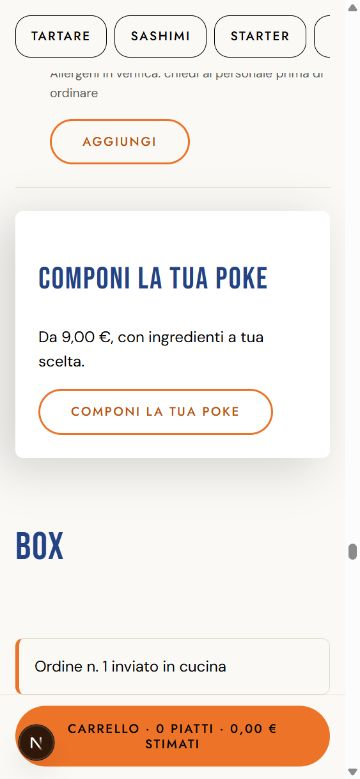
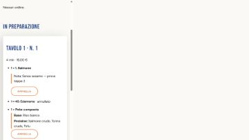
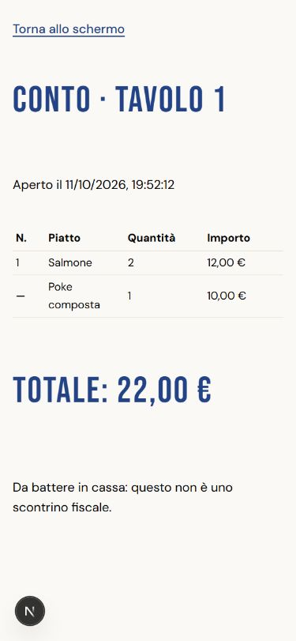
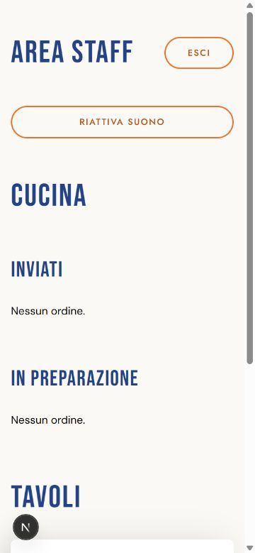

# Verifica della tappa 2 — 11 ottobre 2026

Branch `tappa-2-tavolo`, avviato da `tappa-1-base` come richiesto. La PR #1 della base risulta già unita in `main`, quindi la consegna della tappa 2 è verso `main`.

## Controlli del codice

- `npm test`: 29 file, **149 test superati**, senza warning. Dominio, Server Actions e SQL su PGlite con migrazioni e seed reali.
- `npm run typecheck`, `npm run lint`, `npm run build`: superati senza flag. La build è stata eseguita con `.env.local` temporaneamente rimossa e poi ripristinata.
- Revisione rispetto a spec §4.2, §4.3, §5 e Review Focus del piano: prezzi ricalcolati sul server, ordini atomici, chiusura concorrente, esauriti, codice/rate limit, collisioni tra sessioni, note e copie storiche.
- Le richieste HTTP senza cookie a `/admin`, `/admin/poke`, `/admin/tavoli`, `/staff` e `/staff/conto/[sessione]` restituiscono redirect 307 all'accesso. Ogni nuova pagina/azione riservata verifica il ruolo prima di usare il DB.
- Verifica aggiuntiva del driver reale: `npx tsx --env-file=.env.local scripts/verifica-poke-postgres.ts`. Salva e rilegge JSON e prezzi usando una tabella temporanea; nessuna modifica persistente.
- Non è presente un workflow CI nel repository; le verifiche sopra sono locali.

## Database reale

Su `daniel-sushi` (`rxsywhdznaugfhmsdjsa`), con consenso dell'utente, applicata la migrazione `20261012120000_tavoli_e_ordini.sql` e registrata nella cronologia Supabase nella stessa transazione.

Le cinque nuove tabelle hanno RLS attiva, zero policy e privilegi SELECT/INSERT/UPDATE/DELETE revocati per `anon` e `authenticated`; revocati anche i privilegi sulle sequenze. Nessuna modifica a menù, ruoli o impostazioni Auth da parte della migrazione.

Security Advisor: **0 errori**, 9 segnalazioni informative «RLS Enabled No Policy» e 1 warning Auth «Leaked Password Protection Disabled». Il warning riguarda una configurazione Auth esterna alla migrazione; non è stato modificato durante questa prova.

## Prova nel browser

Accesso admin eseguito personalmente dall'utente. Flusso provato su localhost con più schede del browser integrato:

1. Creazione di Tavolo 1 e Tavolo 2; impostazione temporanea della poke a 9,00 € + 1,00 € per extra. Due SVG QR visibili con URL corretti dei tavoli.
2. Inizio turno, apertura Tavolo 1, errore con codice sbagliato e accesso con quello corretto.
3. Carrello con Salmone, Edamame e poke con tre proteine; nota «Senza sesamo — prova tappa 2». Prezzo poke 10,00 €, totale ordine 19,00 €. Ricaricamento conserva righe e nota. Il composer impedisce aggiunte senza le scelte obbligatorie.
4. Invio con messaggio di successo visibile, carrello svuotato e comanda arrivata nello staff con nota e ingredienti. Un'altra scheda cliente vede lo stesso ordine.
5. Passaggio in preparazione, annullamento Edamame: totale 16,00 €. Passaggio a servito: ordine rimosso dalla cucina e stato aggiornato al cliente.
6. Edamame esaurito dopo l'aggiunta al carrello: invio rifiutato con il nome, nessun ordine o riga salvati; resta l'altro piatto del carrello. Disponibilità ripristinata.
7. Secondo ordine Salmone: conto raggruppato con Salmone quantità 2 e poke quantità 1, totale 22,00 €, esclusa la riga annullata. Annullando il secondo ordine il totale ritorna 16,00 €.
8. Chiusura con carrello ancora pieno: invio rifiutato con «Il tavolo è stato chiuso: chiedi al personale», nessun nuovo ordine; al refresh compare il messaggio di chiusura. Riapertura con un codice diverso.
9. Tavolo 2: dopo cinque errori, il sesto tentativo è bloccato; anche il codice giusto resta bloccato.
10. Pagine nuove admin, QR, staff, conto, codice, menù e dialoghi controllati a 375 px senza overflow della pagina. Sfondo `rgb(251, 249, 246)`; dialoghi chiudibili con Esc.

Aggiornamenti automatici osservati nel browser; intervalli di 5 s staff e 10 s cliente verificati nel codice. La prova non misura rigorosamente la latenza massima. Le schede condividono il contesto del browser: non equivalgono a due telefoni o a un profilo incognito. Il percorso pubblico non usa il login admin e la protezione delle pagine riservate è verificata anche con richieste senza cookie.

Restano da verificare in sala su dispositivi reali: udibilità del suono, permanenza dello schermo acceso, sospensione/ripresa del browser e ciclo offline/riconnessione. Non effettuati stampa fisica o scansione telefonica; verificati gli URL degli SVG. Per i QR in sala va configurato `APP_URL` con un indirizzo raggiungibile dai telefoni.

## Correzioni emerse dalla prova e dalla revisione

- I parametri JSON del driver `postgres` richiedono cast tramite `text` prima di `jsonb`, per evitare di salvare stringhe JSON annidate. Riprodotto il difetto con il driver reale, corretto e verificato il round-trip; le scelte poke sono oggetti JSON.
- Conferme staff tramite dialoghi accessibili nell'app, con focus e Esc, evitando il blocco delle conferme native del browser integrato.
- Messaggio di successo visibile sopra la barra carrello; protezione delle aggiunte durante l'invio.
- Validazione strutturale delle poke nel carrello ripristinato da storage; test contro dati malformati.
- Gli esauriti restituiscono nomi per il messaggio e ID per rimuovere solo le righe corrette, anche con piatti omonimi. Test scritto e visto fallire prima della correzione.
- Test aggiuntivi su ordini misti senza scritture parziali e annullamenti concorrenti con totale corretto; verifica del ruolo anche sul redirect `/admin`.

## Pulizia autorizzata

Con consenso separato dell'utente, in una transazione con verifica preventiva di identità e conteggi, eliminati esclusivamente i dati della prova: **2 ordini, 4 righe, 3 sessioni, 6 tentativi**. I due tavoli restano attivi, senza sessioni aperte. I prezzi poke sono tornati entrambi `null`, come prima della prova: la poke composta resta indisponibile finché vengono configurati. Edamame è disponibile.

Controllo finale DB: 2 tavoli, 0 ordini, 0 righe, 0 sessioni, 0 tentativi. Le sequenze degli ordini non sono state azzerate.

## Immagini della prova

Le prime tre immagini rappresentano il flusso prima della pulizia; l'ultima mostra la cucina vuota dopo la pulizia.

La tappa 3 (domicilio e asporto) resta fuori da questa consegna.
